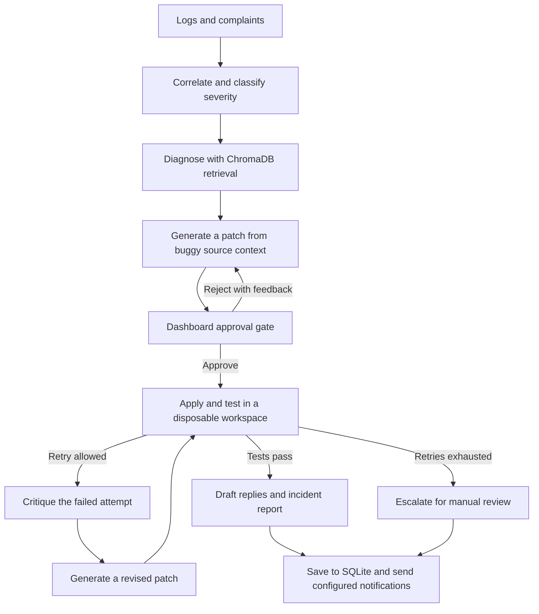

# Multi-agent incident response

This research prototype takes error logs and customer complaints, proposes a single-file Python patch, and checks it against tests. The Streamlit dashboard pauses for human approval before executing the first candidate. After validation, the system drafts customer replies and an incident report. Slack notifications and GitHub pull requests are optional. A pull request still needs a reviewer to merge it.

## Architecture



LangGraph runs diagnosis and execution as separate graphs in the dashboard. A SQLite checkpoint restores a pending review by run ID. The webhook runs a single graph without that dashboard gate. Benchmarks also auto-approve, as detailed in the [evaluation protocol](docs/evaluation/selection.md).

## Quick start

From the repository root, install the dependencies, build the sandbox image, and configure the ignored `.env` file.

```sh
python -m pip install -r requirements.txt
docker build -t incident-execution-sandbox:local sandbox
cp -n .env.example .env
```

Choose one provider and supply its key. For DeepSeek, set `LLM_PROVIDER=deepseek`, `DEEPSEEK_MODEL=deepseek-flash`, and `DEEPSEEK_API_KEY`. For Groq, set `LLM_PROVIDER=groq`, `LLM_MODEL=openai/gpt-oss-20b`, and `GROQ_API_KEY`. The model ID must be available to the configured provider. [Full configuration examples](docs/execution-and-approval.md#provider-configuration)

```sh
python -m rag.ingestion
SANDBOX_MODE=docker streamlit run frontend/app.py
# Optional webhook
SANDBOX_MODE=docker uvicorn api.webhook:app --port 8000
```

Docker is the execution default. On the Docker host, each attempt uses a fresh repo copy in a non-root, network-disabled container with a read-only root filesystem, a writable workspace, and resource limits.

`docker compose up --build` starts the dashboard and webhook in service containers. Compose explicitly uses subprocess execution and provides no Docker socket. This gives service-container isolation from the host. Candidates still share the service container's filesystem and network. Run the controller on the Docker host for per-run Docker isolation. [Compose and approval recovery](docs/execution-and-approval.md)

## Evaluation

The comparison uses `bench-v0-deepseek-flash` (v0) and `bench-v1-nocontracts` (v1 without contracts), both with `deepseek-flash`, thinking disabled, temperature 0.2, a 4,096-token output cap, and empty fallback. Each suite has its own denominator. Target-file choice is a secondary diagnostic. The frozen scorer also checks the expected path before testing.

### Synthetic regression suite

The seven scenarios use service tests and private behavioral tests. Both groups must pass for a resolve. They play the behavioral verification and regression-control roles that fail-to-pass and pass-to-pass serve in BugsInPy. The mean pools the case-trials. The range is across complete rounds. [Per-scenario results and disagreement matrix](docs/evaluation/synthetic.md)

<!-- evaluation:synthetic -->
| Metric | v0 | v1 without contracts |
| --- | --- | --- |
| Trial resolves (mean) | 15/35 (42.9%) | 13/35 (37.1%) |
| Resolves by round | 2/7, 3/7, 4/7, 3/7, 3/7 | 3/7, 2/7, 2/7, 4/7, 2/7 |
| Round resolve-rate range | 28.6%–57.1% | 28.6%–57.1% |
| Invalid trials | 0 | 0 |
<!-- /evaluation -->

### BugsInPy development set

A trial resolves when the fail-to-pass target passes and the pass-to-pass controls still pass. A distinct bug resolves if any trial resolves. The range is across complete rounds. Black accounts for 11 of the 15 cases. This set informed development. [Per-bug results and failure analysis](docs/evaluation/development.md)

<!-- evaluation:development -->
| Metric | v0 | v1 without contracts |
| --- | --- | --- |
| Trial resolves (mean) | 6/45 (13.3%) | 9/45 (20.0%) |
| Distinct bugs resolved | 2/15 | 3/15 |
| Resolves by round | 2/15, 2/15, 2/15 | 3/15, 3/15, 3/15 |
| Round resolve-rate range | 13.3%–13.3% | 20.0%–20.0% |
<!-- /evaluation -->

### BugsInPy held-out set

The held-out set contains 12 cases from repositories outside the development set. The same fail-to-pass and pass-to-pass rule applies. The Wilson intervals use cases as the unit, with a case counted as resolved if any trial resolves. v1 without contracts resolved **3 of 12 distinct cases**, compared with **1 of 12** for v0. This difference is not statistically established. The pre-registered shipping rule used the observed distinct case counts and selected v1 without contracts as the default. [Full held-out report](docs/evaluation/held-out.md)

<!-- evaluation:held-out -->
| Metric | v0 | v1 without contracts |
| --- | --- | --- |
| Trial resolves | 3/36 (8.3%) | 7/36 (19.4%) |
| Distinct cases resolved | 1/12 (8.3%) | 3/12 (25.0%) |
| Case-level Wilson 95% interval | 1.5%–35.4% | 8.9%–53.2% |
<!-- /evaluation -->

### Negative results

- Adding function contracts and verdict counts reduced synthetic resolves from 22/35 to 11/35 in the sequential ablation. v2 added top-three source windows and retry diversification. Its 3 distinct development bugs and 10/35 synthetic resolves missed both acceptance thresholds of 5 distinct bugs and 15/35 synthetic resolves. [Ablations](docs/evaluation/ablations.md)
- The Flash thinking diagnostic was confounded by the 4,096-token cap. Some responses exhausted the budget before producing parseable output, so the thinking comparison is inconclusive. [Model-sensitivity diagnostic](docs/evaluation/model-sensitivity.md)
- Localization remains a bottleneck. Retries rarely found the expected file in terminal wrong-file trials. The offline replay found no saved wrong-file candidate that passed both test groups. [Failure analysis](docs/evaluation/development.md) · [Offline replay](docs/evaluation/offline-rescore.md)

### Evaluation controls

The held-out cases were selected and validated before inference with pinned buggy and fixed commits and identical test oracles. Fixed source, private test contents, names, and assertions stay outside model prompts. The shared trace correction removes frames and calls under singular `test/` and plural `tests/` directories before building incident inputs. Synthetic runs seed a temporary knowledge base with bundled static incidents. BugsInPy runs use an empty temporary store. Benchmark auto-approval bypasses dashboard HITL. [Selection, leakage controls, and trace correction](docs/evaluation/selection.md)

### Spend and reproduction

The held-out comparison used 550 requests and cost an estimated $0.178329 from token usage. The final cumulative ledger estimated $1.454171, with $2.730014 charged to the conservative guard. [Spend details](docs/evaluation/spend.md)

```sh
python scripts/check_readme_results.py
python -m pytest tests/ -m 'not integration'
# Verify the private raw archive after restoring it at its original relative paths.
awk '!/^#/' docs/evaluation/CHECKSUMS | shasum -a 256 -c
```

The [reproduction guide](docs/evaluation/reproduce.md) contains offline manifest validation commands and frozen model-run settings. New model runs should be expected to vary in resolutions, runtime, and spend even with the same configuration.

### Retired results

The original report's **100% patch correctness**, **0% false positives**, and **41.1 s average runtime** came from an unavailable model and legacy string-match scoring. Those figures overstated the evidence for correctness. The first modern baseline rounds each matched patterns on 7/7 scenarios while behavioral scoring resolved only 2 to 4 of 7. [Retired scoring and provenance](docs/evaluation/retired.md)

## Limitations and future work

The samples are small, the held-out set leans toward small files, and public fixes may appear in model training data. The primary comparison used one model and configuration, and it evaluated single-file repairs. Approval recovery covers pending reviews. Subprocess and Compose modes lack the per-run Docker sandbox. Future work includes agentic repo exploration for localization and a larger, more diverse held-out set. [Limitations](docs/limitations.md)
